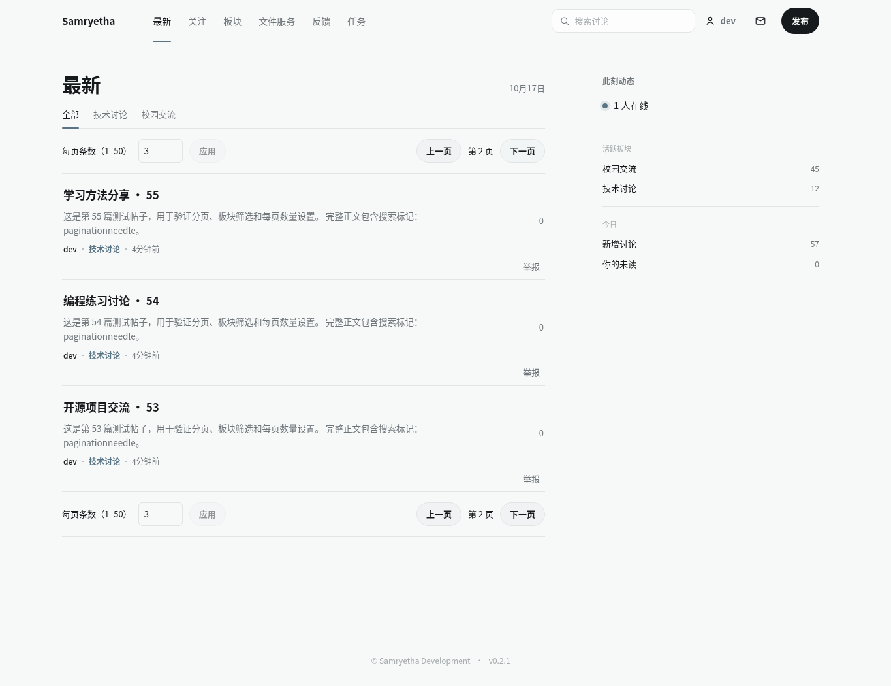
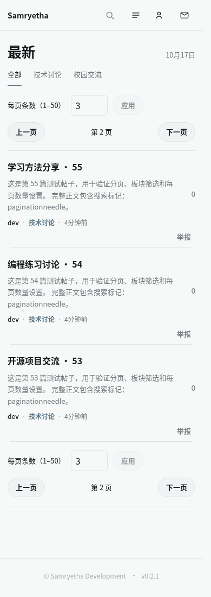

# 帖子列表分页实现报告

日期：2026-10-17。开发基线：同步上游后 fork 的 `dev`（`60be317`）；功能分支：`codex/post-pagination`，PR 目标为上游 `dev`。

## 交付内容

- 主页“最新”“关注”、板块筛选与搜索结果：上下两处分页控件，上一页、下一页和当前页显示。
- 个人主页：帖子、回复和收藏均可分页；“自己的帖子”：已发布与定时任务列表均可分页。
- 每页条数可输入 1–50，默认 20；同浏览器跨页面、刷新后继续使用。浏览器禁止存储时仍能在当前页面调整。
- 改变条数、板块、账号、标签或排序后从第一页查询；加载失败在失败页重试；旧请求不能覆盖新的筛选或账号数据。
- 首页的搜索词、页码与游标历史随浏览器历史条目保存，从帖子返回及刷新可恢复；个人列表不保存页码。
- 板块筛选改为先在服务端筛选再分页，解决原来只在首页前 30 条中筛选而漏帖的问题。
- 搜索接口新增 `offset` 与 `followed`，分页前应用权限、举报隐藏、板块和关注条件；未知板块返回空结果。服务端命中的完整正文不会再被客户端的摘要过滤错误丢弃。
- 简体中文、英文文案与 OpenAPI/生成客户端已更新；新分页冒烟检查已接入 GitHub Actions。

## 验证结果

- 后端全量 pytest：450 项通过；新增分页测试 5 项通过，覆盖搜索 offset/条数边界、隐藏内容、关注筛选和多个列表的自定义条数。
- Ruff、strict basedpyright、compileall：通过。
- 前端 typecheck、客户端与 SSR 构建：通过；SSR 检查的 18 个用例全部通过。
- 新分页 StrictMode 冒烟：通过；验证实际主页与个人页的翻页、条数持久化、恢复、筛选重置、失败重试、旧响应隔离、非法/损坏偏好和存储不可用情况。
- 既有 auth、files、polls、OIDC、write-failure、drag/drop、folders、metadata、usability、scheduled-posts 冒烟：通过。
- 隔离数据库与实际 Chromium：验证每页 9/50/7 条、最后一页、详情返回、板块刷新、搜索恢复、个人帖子/收藏/回复、定时/已发布列表。桌面与手机截图已人工查看，手机布局稳定后无横向溢出，浏览器无运行时异常。

## 接口与部署影响

无需数据库迁移或新环境变量。现有游标分页及可见性规则继续使用。搜索 `offset` 默认 0，范围 0–2147483647；`followed` 默认 false；返回仍为 `{ items, total }`。未知板块搜索从原先忽略筛选改为空结果。

分页使用顺序翻页，不显示总页数，也不支持跳到尚未加载的页。帖子流沿用 keyset；搜索使用 offset，数据在翻页期间更新时可能改变后续页的位置。每页条数属于当前浏览器偏好，不在账号的不同设备之间同步。

已有构建大包提示和 TestClient 依赖弃用提示未阻止验证通过。

## 界面截图

桌面，每页 3 条、第 2 页：

手机，每页 3 条、第 2 页：

