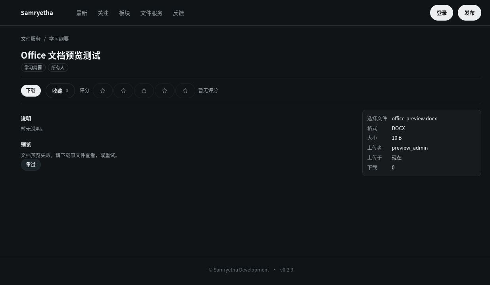

# PR #126 预览修复验证

基线：当前 upstream `dev`，`b571f8c90276144f59091cd2be0064821b5730af`。

| 审查项 | 修复与验证 |
|---|---|
| F01 转换隔离 | 系统 LibreOffice 仅在 Linux bubblewrap 沙箱中运行；未暴露宿主 home/业务数据，隔离网络、PID、环境；不支持的运行环境关闭能力。真实沙箱验证宿主文件不可见、秘密环境未继承、宿主回环端口不可达；真实 Office 文档正常输出正文，未带出服务器图片 |
| F02 连接池与并发 | 获取授权输入后结束 DB 连接；共享文件锁控制跨进程转换数量，同键不重复执行；15 个请求仅触发 1 次转换，其余快速返回 503，转换期间健康检查仍成功 |
| F03 缓存竞争 | 每次调用使用独立临时文件再原子发布；固定并发交错的两个线程均成功，跨进程对象锁和转换槽也有回归覆盖 |
| F04 上传格式 | ODT/ODS/ODP/RTF 均可走完整上传/创建/预览链路，回源 MIME 正确 |
| F05 失败反馈 | 独立 DocumentPreview 组件处理成功、失败、繁忙、未支持；实际 HTTP 404/503、重试成功、身份变化、旧响应和 Blob URL 释放均有前端回归；真实浏览器确认中文失败说明及重试入口 |
| F06 能力误报 | 缺少二进制、隔离环境或使用私有运行时包装器时不声明可用；配置 mode、超时、并发和预算有输入约束 |
| C01–C04 | 清理重复 logger；分离 Office 展示状态与业务输入解析；OpenAPI 声明 PDF 二进制及 400/404/503；版本化缓存、完成态 PDF 预算、离线清理工具与部署流程 |

本地验证：原全套 509 passed（488 原有 + 初版 21 项回归）；随后补充两项超时进程组清理、离线清理工具测试，最终专项 23 passed。真实沙箱与 LibreOffice 集成测试均运行通过。Ruff、basedpyright（0 errors/0 warnings）、Python 编译、前端 typecheck/build、18 条 SSR 路由、Office 预览冒烟、Files StrictMode、认证跳转及写入失败冒烟通过。GitHub CI 在提交后单独确认；CI 未安装 Office/隔离依赖时两项真实引擎测试会跳过，其他拒绝回归仍运行。

部署变化：需要系统 LibreOffice、bubblewrap、util-linux、CJK 字体和可用的非特权用户命名空间；不满足时仍可下载。默认缓存版本更换，避免复用未隔离转换的旧 PDF；默认最多 2 个转换和 512 MiB 完成态缓存。旧缓存回收、字体/引擎升级时版本提升见 architecture.md。没有数据库迁移。

